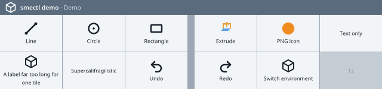

# smed

A Linux driver daemon for the **3Dconnexion SpaceMouse Enterprise** (USB `256f:c633`), aiming at
what 3DxWare 10 does on Windows: every key, long presses, the rotation lock with its LED, and
the LCD with labels and icons from the application in use.

> **Status: early (0.2, in development).** smed reads the device and reports all of it to
> clients over its own API: the six axes, all 31 keys by their 3Dconnexion IDs with short and
> long press, and the rotation lock with its LED. It draws the LCD from the labels and icons
> the focused client sends and calls it back with the command of a key (API 2). It also serves
> the spacenavd/libspnav socket, so Blender and FreeCAD work unchanged. Not yet: keyboard keys
> as real key presses, window-focus detection, axis settings for libspnav clients.

Not affiliated with or endorsed by 3Dconnexion. "3Dconnexion" and "SpaceMouse" are trademarks
of their owner and are used here only to name the hardware.

## Why

spacenavd drives the motion and the keys of most 3Dconnexion devices, but the Enterprise needs
more. Blender expects 3Dconnexion's button IDs (up to 176), which spacenavd cannot map past 63.
Long presses (HID report `0x1d`), the rotation-lock LED and the LCD are not handled at all.

## What it does

- Runs per user (`systemd --user`) and owns the device through hidraw. Unplugging and
  re-plugging is handled.
- Reports to any number of clients over a Unix socket at `$XDG_RUNTIME_DIR/smed/api.sock`, in
  JSON lines ([docs/api.md](docs/api.md)):
  - motion: the raw axes;
  - every key by its 3Dconnexion ID, with whether the press was short or long;
  - the rotation lock. smed keeps the lock: the Lock key toggles it, the LED follows, and
    rotation is zeroed while it is on. Clients can switch it too.
- Draws the LCD (API 2): the client whose window has the focus sends its application name,
  a catalogue of commands with labels and SVG or PNG icons, and which command each of the
  keys 1–12 runs per environment; smed shows them as 12 tiles over the keys and sends the
  client the command when such a key is pressed. Brightness,
  text size and a dark or light theme are smed's settings.
- Serves the spacenavd/libspnav socket at `$XDG_RUNTIME_DIR/spnav.sock`
  ([docs/spnav.md](docs/spnav.md)) for programs built on libspnav (Blender, FreeCAD): motion
  as spacenavd sends it, every key by its 3Dconnexion ID (what Blender expects), and the long
  presses as 3DxWare maps them (T long is Bottom, V1 long saves view 1, …).
- Attaches no meaning to keys: what a key does is the application's choice.



What we know about the device's protocol is in [docs/protocol.md](docs/protocol.md).

| Crate | What |
| --- | --- |
| `crates/smed` | the daemon |
| `crates/smed-client` | API message types, key table and a blocking client, for Rust applications |
| `crates/smectl` | command line: `smectl monitor`, `smectl state`, `smectl lock on\|off`, `smectl lcd`, `smectl demo-page`, `smectl screenshot` |

## Install from source

Needs Rust 1.88 or newer.

```bash
cargo install --locked --root ~/.local --path crates/smed
cargo install --locked --root ~/.local --path crates/smectl

# device access for the logged-in user (as root)
sudo install -m 644 dist/70-smed.rules /etc/udev/rules.d/
sudo udevadm control --reload && sudo udevadm trigger

# the user service
mkdir -p ~/.config/systemd/user
sed 's|^ExecStart=/usr/bin/smed|ExecStart=%h/.local/bin/smed|' dist/smed.service \
    > ~/.config/systemd/user/smed.service
systemctl --user daemon-reload
systemctl --user enable --now smed

# libspnav clients (Blender, FreeCAD) find smed's spnav socket from the next login
mkdir -p ~/.config/environment.d
install -m 644 dist/environment.d/smed.conf ~/.config/environment.d/

smectl monitor    # every event as a JSON line
smectl lcd --brightness 60 --theme light   # until smed restarts
smectl demo-page  # a sample page on the LCD while it runs
smectl screenshot lcd.png   # what smed draws on the LCD now, as PNG
```

Settings that last go in `~/.config/smed/config.toml` (read at start, never written by smed;
`smed --config PATH` reads another file):

```toml
[lcd]
brightness = 100      # 0-100
text_size = "small"   # or "large"
theme = "light"       # or "dark"

[spnav]
enabled = true        # false: no spacenavd/libspnav socket (then remove smed.conf too)
```

smed and spacenavd should not both run: stop spacenavd while smed is in use
(`sudo systemctl disable --now spacenavd`). smed warns in its log when it sees spacenavd.

## Clients

- [SolidCraft](https://github.com/tangency-labs/solidcraft): a backend for smed is in
  preparation (all keys, long-press jobs, the lock; the LCD next).
- [Blender](https://www.blender.org), FreeCAD and other libspnav programs: through the spnav
  socket, unchanged ([docs/spnav.md](docs/spnav.md)). `tools/spnav-check.py` checks it through
  the system's libspnav.
- Your own: speak the JSON lines from [docs/api.md](docs/api.md) directly, or use the
  `smed-client` crate.

## Plans

1. Window-focus detection; keyboard keys (Esc, Ctrl, …) as real key presses for the focused
   window; axis settings (dead zone, speed, inversion) per program for libspnav clients.
2. An on-screen display, radial menus, macros, a settings tool with your own key assignments.

## Development

`cargo xtask check` runs every gate a change has to pass: formatting, clippy (no `unwrap`,
`expect` or `panic` outside tests), the tests with the LCD goldens, a build with the oldest
supported Rust, cargo-deny (licences, advisories, sources), the packaged crates built and tested
on their own, and cargo-semver-checks for `smed-client`. It needs rustup, Rust 1.88 besides the
pinned toolchain (`rust-toolchain.toml`), and the cargo tools at the versions it names when one
is missing. A change that draws the LCD differently on purpose updates the goldens with
`SMED_BLESS=1 cargo test -p smed --test golden`.

[cargo-mutants](https://mutants.rs) shows behaviour the tests would not notice changing. It is
no gate: run it on the lines a branch changes,
`git diff origin/master -- '*.rs' > /tmp/change.diff && cargo mutants --in-diff /tmp/change.diff`,
and add a test for each missed mutant that matters. `.cargo/mutants.toml` leaves out the code no
unit test can reach (the real USB and hidraw devices, the daemon's process wiring), each with
its reason.

## Licence

`MIT OR Apache-2.0` ([LICENSE-MIT](LICENSE-MIT), [LICENSE-APACHE](LICENSE-APACHE)). No
spacenavd (GPL) or libspnav code is used, only their socket protocol.

The daemon embeds the Noto Sans font (Regular, SemiBold) for the LCD, under the SIL Open Font
License 1.1: [crates/smed/fonts/OFL.txt](crates/smed/fonts/OFL.txt).
